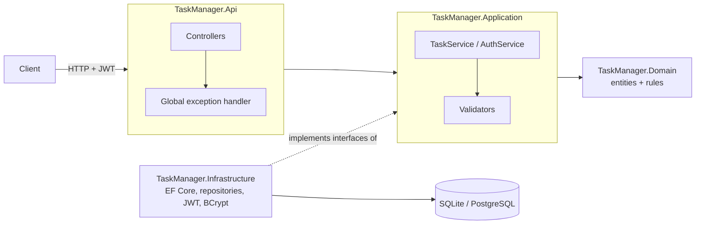

# Task Manager API

[](https://github.com/Victor-Hugo-Oliveira/task-manager-api/actions/workflows/ci.yml)


A REST API for personal task management, built with **ASP.NET Core 10** and **Clean Architecture**.
Users sign up, log in with **JWT**, and manage their own tasks with filtering, search, sorting,
pagination and a progress summary. Each user only ever sees their own data.

## Features

- **Authentication**: register and login with JWT bearer tokens; passwords hashed with BCrypt
- **Per-user isolation**: every query is scoped to the authenticated user; other users' tasks return `404`
- **Task CRUD** with status (`Pending` → `InProgress` → `Done`), priority and due date
- **Querying**: filter by status/priority, case-insensitive search, sort by 5 fields, paginated responses
- **Summary endpoint**: counts by status, overdue tasks and completion rate
- **Validation** with FluentValidation and consistent **RFC 9457 ProblemDetails** errors
- **Interactive docs** with OpenAPI + [Scalar](https://scalar.com/)
- **Two databases**: SQLite for local development, PostgreSQL in Docker/production, each with its own migrations
- **66 automated tests** (unit + integration) and a Docker smoke test running on every push

## Tech stack

| Area | Tools |
|---|---|
| Framework | ASP.NET Core 10 (controllers), C# 14 |
| Data | Entity Framework Core 10, SQLite, PostgreSQL (Npgsql) |
| Auth | JWT bearer, BCrypt.Net-Next |
| Validation | FluentValidation |
| Docs | OpenAPI, Scalar |
| Tests | xUnit, NSubstitute, `FakeTimeProvider`, `WebApplicationFactory` |
| DevOps | Docker, Docker Compose, GitHub Actions |

## Architecture



| Project | Responsibility | Depends on |
|---|---|---|
| `Domain` | Entities (`TaskItem`, `User`) and their rules; no framework code | — |
| `Application` | Use cases, DTOs, validators, and interfaces (`ITaskRepository`, `ITokenService`…) | Domain |
| `Infrastructure` | EF Core `DbContext`, migrations, repositories, JWT and BCrypt implementations | Application |
| `Api` | Controllers, auth setup, error handling, OpenAPI | Application, Infrastructure |

The core (`Domain` + `Application`) has no reference to EF Core or ASP.NET, so business rules
are tested without a database or web server.

## Getting started

### Option 1: Docker (API + PostgreSQL)

Requires [Docker](https://docs.docker.com/get-docker/).

```bash
docker compose up --build
```

Open **http://localhost:8080/scalar**. Migrations are applied automatically on startup.

### Option 2: Local (.NET SDK + SQLite)

Requires the [.NET 10 SDK](https://dotnet.microsoft.com/download).

```bash
dotnet run --project src/TaskManager.Api
```

Open **http://localhost:5110/scalar**. A local `taskmanager.db` file is created on first run.

### Trying it out

1. `POST /api/auth/register` with a name, email and password (8+ characters, at least one letter and one digit).
2. Copy the `accessToken` from the response.
3. In Scalar, paste the token in the **Authentication** field, then call the `/api/tasks` endpoints.

The file [`src/TaskManager.Api/TaskManager.Api.http`](src/TaskManager.Api/TaskManager.Api.http) has ready-made
requests for VS Code (REST Client) and Visual Studio.

## API reference

| Method | Route | Auth | Description |
|---|---|---|---|
| `POST` | `/api/auth/register` | — | Create an account, returns a token (`201`) |
| `POST` | `/api/auth/login` | — | Exchange credentials for a token |
| `GET` | `/api/tasks` | ✔ | List tasks (filters, search, sorting, paging) |
| `GET` | `/api/tasks/{id}` | ✔ | Get one task |
| `POST` | `/api/tasks` | ✔ | Create a task (`201` + `Location`) |
| `PUT` | `/api/tasks/{id}` | ✔ | Update title, description, priority, due date |
| `PATCH` | `/api/tasks/{id}/status` | ✔ | Change only the status |
| `DELETE` | `/api/tasks/{id}` | ✔ | Delete a task (`204`) |
| `GET` | `/api/tasks/summary` | ✔ | Counts by status, overdue, completion rate |
| `GET` | `/health` | — | Liveness + database check |

### Query parameters for `GET /api/tasks`

| Parameter | Values | Default |
|---|---|---|
| `status` | `Pending`, `InProgress`, `Done` | all |
| `priority` | `Low`, `Medium`, `High` | all |
| `search` | text matched in title and description, case-insensitive | — |
| `sortBy` | `CreatedAt`, `DueDate`, `Priority`, `Title`, `Status` | `CreatedAt` |
| `sortDirection` | `Asc`, `Desc` | `Desc` |
| `page` / `pageSize` | `page` ≥ 1, `pageSize` 1–100 | `1` / `10` |

```http
GET /api/tasks?status=Pending&sortBy=DueDate&sortDirection=Asc&page=1&pageSize=20
Authorization: Bearer <token>
```

```json
{
  "items": [
    {
      "id": "4f49e27b-db44-48c6-ad32-7799ad227e0d",
      "title": "Prepare monthly report",
      "description": null,
      "status": "Pending",
      "priority": "High",
      "dueDate": "2026-12-10T00:00:00Z",
      "createdAt": "2026-11-11T21:21:56.75Z",
      "updatedAt": null,
      "completedAt": null
    }
  ],
  "page": 1,
  "pageSize": 20,
  "totalCount": 1,
  "totalPages": 1,
  "hasPreviousPage": false,
  "hasNextPage": false
}
```

### Errors

Every error uses the same [RFC 9457](https://www.rfc-editor.org/rfc/rfc9457) shape:

```json
{
  "type": "https://tools.ietf.org/html/rfc9110#section-15.5.1",
  "title": "One or more validation errors occurred.",
  "status": 400,
  "instance": "POST /api/tasks",
  "errors": {
    "Title": ["Title is required."],
    "DueDate": ["Due date cannot be in the past."]
  },
  "traceId": "0HNQ074GKTATI:00000001"
}
```

| Status | When |
|---|---|
| `400` | Invalid body or query parameters |
| `401` | Missing/invalid token, or wrong email/password |
| `404` | Task doesn't exist **or belongs to another user** |
| `409` | Email already registered |
| `500` | Unexpected error (logged; no internals exposed) |

## Running the tests

```bash
dotnet test
```

- **Unit tests** (`tests/TaskManager.UnitTests`): domain rules, validators and services, with mocked
  repositories and a fake clock.
- **Integration tests** (`tests/TaskManager.IntegrationTests`): boot the real API in memory with
  `WebApplicationFactory` and a private in-memory SQLite database (applying the real migrations), then
  test it over HTTP, including the full CRUD flow, auth errors and cross-user isolation.
- **Docker smoke test** ([`scripts/smoke-test.sh`](scripts/smoke-test.sh)): runs in CI against
  `docker compose` with PostgreSQL. It covers register, auth, create, complete, accented search, summary and delete.

## Configuration

Settings come from `appsettings.json` and can be overridden with environment variables (`:` becomes `__`).

| Setting | Description | Default |
|---|---|---|
| `ConnectionStrings__DefaultConnection` | Database connection string | `Data Source=taskmanager.db` |
| `Database__Provider` | `Sqlite` or `Postgres` | `Sqlite` |
| `Database__MigrateOnStartup` | Apply migrations at startup (always on in Development) | `false` |
| `Jwt__Secret` | Token signing key, **at least 32 characters**; the app refuses to start without it | — |
| `Jwt__Issuer` / `Jwt__Audience` | Token issuer and audience | `TaskManager.Api` / `TaskManager.Client` |
| `Jwt__ExpirationMinutes` | Token lifetime | `60` |

> The secret in `appsettings.Development.json` and the defaults in `docker-compose.yml` are for local
> demos only. In production, provide `Jwt__Secret` and the database password through environment variables
> or a secret store.

### Migrations

Each database has its own migration set:

```bash
# SQLite
dotnet dotnet-ef migrations add <Name> --context SqliteAppDbContext \
  -p src/TaskManager.Infrastructure -s src/TaskManager.Api -o Persistence/Migrations/Sqlite

# PostgreSQL
dotnet dotnet-ef migrations add <Name> --context PostgresAppDbContext \
  -p src/TaskManager.Infrastructure -s src/TaskManager.Api -o Persistence/Migrations/Postgres
```

`dotnet-ef` is pinned as a local tool. Run `dotnet tool restore` once.

## Design decisions

- **Ownership checks live in the repository.** Every read takes the user id, so no endpoint can
  forget the filter. A task owned by someone else is reported as `404`, not `403`, so its existence isn't leaked.
- **Login failures look identical.** "Unknown email" and "wrong password" return the same message, and
  the unknown-email path still runs a password check, so response time doesn't reveal registered emails.
- **Enums are stored as text** for readable data, and sorting by priority/status uses a SQL `CASE`
  ranking so `High > Medium > Low` instead of alphabetical order.
- **Stable pagination**: sorts always end with tie-breakers (`CreatedAt`, `Id`), so items don't jump
  between pages.
- **All dates are UTC** end-to-end, enforced by an EF Core value converter (SQLite has no timezone type).
- **Time is injected** (`TimeProvider`), so rules like "due date can't be in the past" are unit-tested
  with a fixed clock.
- **Fail fast on bad config**: missing or short JWT secrets stop the app at startup, not at first login.

## Project structure

```
├── src/
│   ├── TaskManager.Api/              # Controllers, Program.cs, error handling, OpenAPI
│   ├── TaskManager.Application/      # Services, DTOs, validators, interfaces
│   ├── TaskManager.Domain/           # Entities and enums
│   └── TaskManager.Infrastructure/   # EF Core, migrations (Sqlite/Postgres), repositories, auth
├── tests/
│   ├── TaskManager.UnitTests/
│   └── TaskManager.IntegrationTests/
├── scripts/smoke-test.sh             # End-to-end check used by CI
├── Dockerfile
├── docker-compose.yml
└── .github/workflows/ci.yml
```
